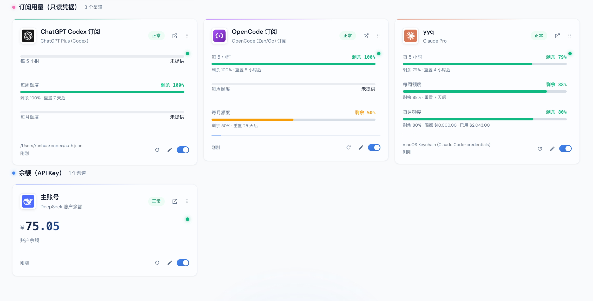
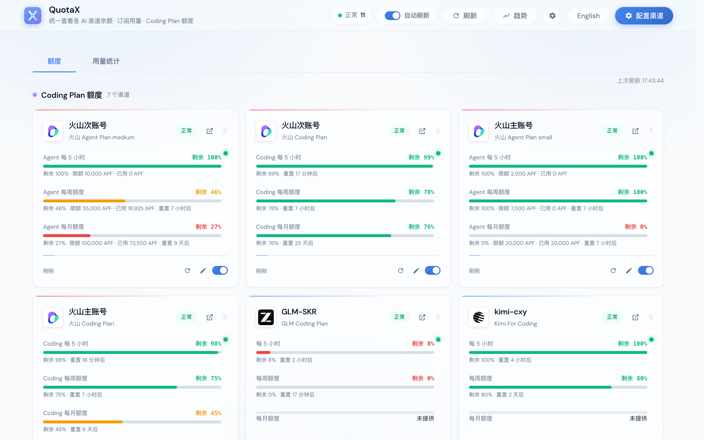
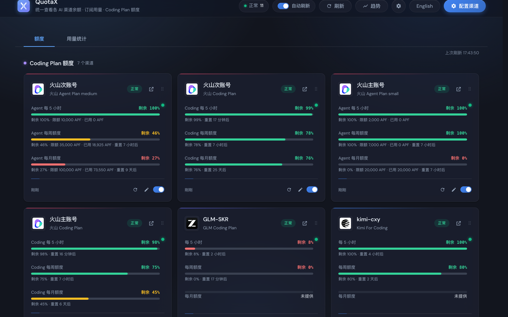
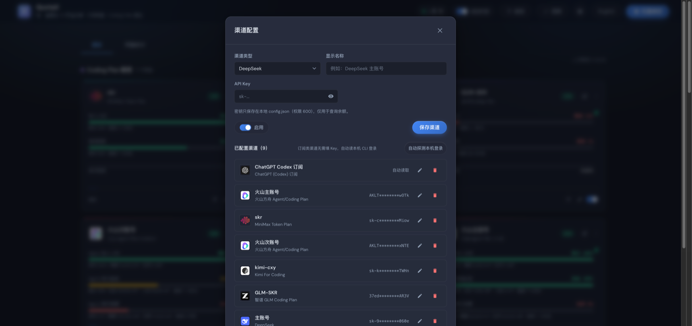
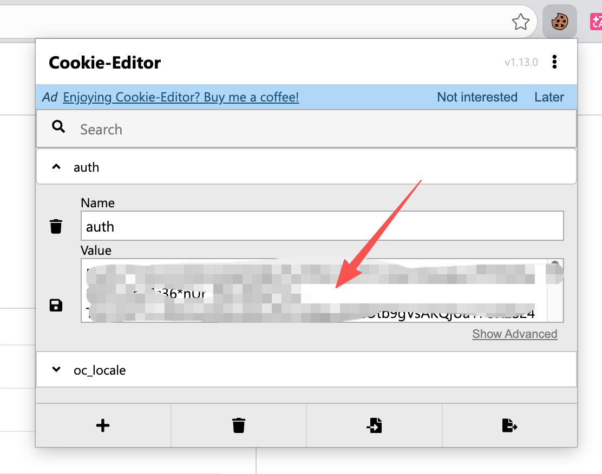
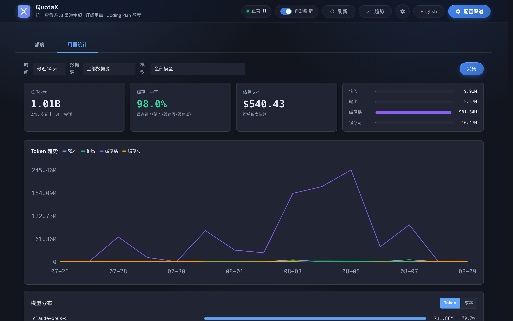
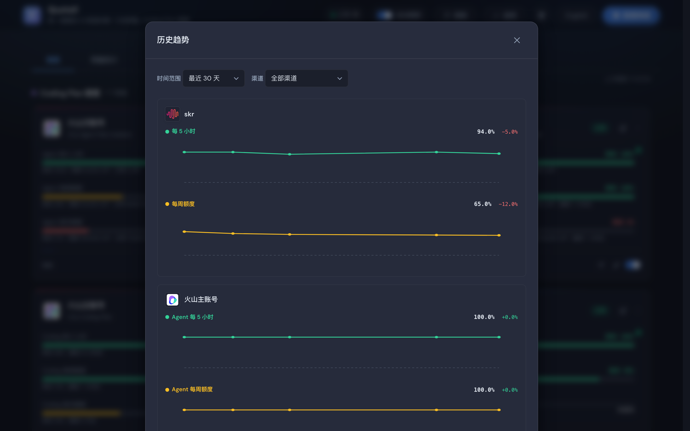
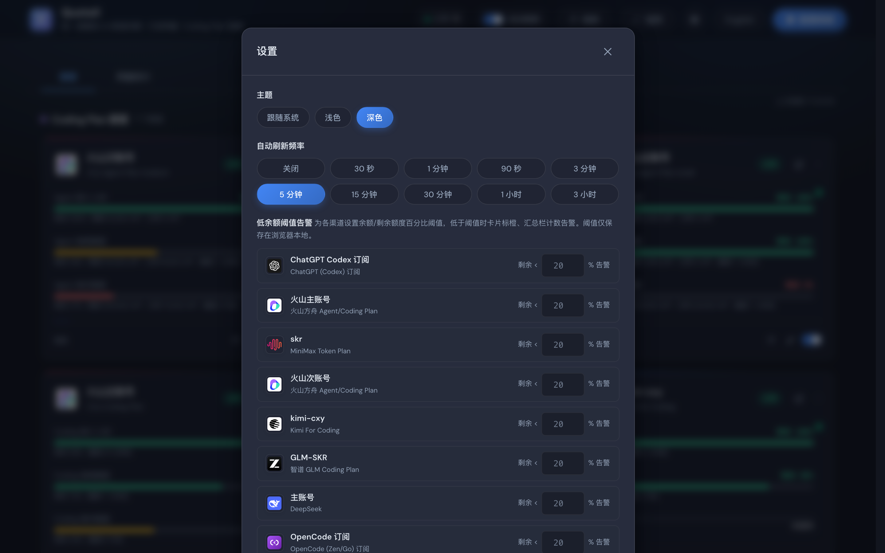

# QuotaX

> A local WebUI to view all your AI **credits · subscription usage · Coding Plan quotas** in one place.

English | [简体中文](./README.md)

Aggregate balances and quotas scattered across vendor websites, CLIs, and consoles onto a single local dashboard. Subscription channels auto-read your local CLI login state — no API keys needed.



Top: subscription usage (Claude / Codex / OpenCode, auto-reading local CLI logins). Bottom: API-Key balance (DeepSeek). Each channel is a card with remaining-percentage + reset countdown at a glance.



---

## Features

- **Multi-channel aggregation**: Balance (DeepSeek / Stepfun / SiliconFlow / OpenRouter / Novita / Kimi API / new-api·one-api proxies), Coding Plans (Kimi / Zhipu GLM individual+team / MiniMax / Volcengine Ark / ZenMux / Xiaomi MiMo), Subscription usage (Claude / Gemini / Grok / Codex / Copilot / OpenCode), Local stats (Claude Code / OpenCode transcripts).
- **Zero-key subscriptions + auto-detect**: Reads local CLI credentials (Claude / Gemini / Grok / Codex / Copilot) — **no refresh, no write**, sharing the same login state as your agent. On startup it auto-detects locally logged-in CLIs and creates channels for them — no manual setup needed.
- **Usage analytics dashboard**: A dedicated tab with SQLite-persisted incremental collection — four-bucket token overview, cache hit rate, daily trend curves, model distribution, per-request log, cost estimation (LiteLLM pricing + rebill).
- **Codex OAuth in-browser**: ChatGPT subscriptions support one-click "Login with ChatGPT" OAuth — automatically obtains credentials and creates the channel.
- **Per-channel refresh + request coalescing**: successful data follows the selected interval, transient errors back off, and 429 cooldowns are respected; slow providers do not delay other cards.
- **Drag-to-reorder**: Cards can be dragged to customize order; persisted to browser `localStorage`.
- **History trends**: Each successful query records a data point; SVG line charts show balance / remaining-percent over time.
- **Browser-independent monitoring**: Thresholds persist in the backend; optional desktop/Webhook alerts, cooldowns, and recovery notifications keep working after the browser closes (off by default until explicitly enabled).
- **Bilingual (zh / en)**: Toggle between Simplified Chinese and English with one click.
- **Dark / light theme**: Follow system or set manually.
- **CLI tool**: `quotaboard quota --brief` one-line summary, great for tmux statusbar / shell prompts.
- **Config import / export**: Full backup with secrets (machine migration) or redacted export (safe to share channel structure).



## One-line install

Open a terminal and paste the command for your OS. The script downloads the source, prepares the Python runtime, installs all dependencies, starts the service, and opens your browser.

**macOS / Linux:**

```bash
curl -fsSL https://raw.githubusercontent.com/RunhuaHuang/quotax/v1.3.0/install.sh | bash
```

**Windows (PowerShell):**

```powershell
irm https://raw.githubusercontent.com/RunhuaHuang/quotax/v1.3.0/install.ps1 | iex
```

> - First install prepares the runtime: **prefers reusing any local Python 3.11+**; only installs Python 3.13 automatically if none is found. No need to pre-install Python. Please allow 1–2 minutes.
> - Installs to `~/QuotaX` (`%USERPROFILE%\QuotaX` on Windows); service listens on `127.0.0.1:8900`.
> - **Auto-detect on install**: locally logged-in CLIs (Claude / Codex / Gemini / Grok / Copilot) are recognized and channels created automatically — no manual setup.
> - **Network blocked / GitHub firewalled?** The script has built-in multi-mirror fallback (GitHub → ghfast.top → gh-proxy.com → moeyy); or pin a mirror manually:
>   ```bash
>   QUOTAX_MIRROR=https://ghfast.top bash -c "$(curl -fsSL https://raw.githubusercontent.com/RunhuaHuang/quotax/v1.3.0/install.sh)"
>   ```
>   ```powershell
>   $env:QUOTAX_MIRROR='https://ghfast.top'; irm https://raw.githubusercontent.com/RunhuaHuang/quotax/v1.3.0/install.ps1 | iex
>   ```
> - **Upgrade**: just re-run the same command; personal data (`config.json` / `monitor-state.json` / `usage.db` / `history/`) is preserved.

### Opening later

After the first install, open the app any time by typing in a terminal:

```
quotax
```

This starts the background service and opens the browser (or just opens the browser if already running). Other commands:

| Command | Action |
| --- | --- |
| `quotax` | Start service and open WebUI (or open browser if running) |
| `quotax stop` | Stop the background service |
| `quotax status` | Show running status |
| `quotax log [N]` | Show last N log lines (default 50, macOS/Linux only) |

## Supported channels

| Category | Channels | Auth |
| --- | --- | --- |
| Balance | DeepSeek / Stepfun / SiliconFlow / OpenRouter / Novita / Kimi API / new-api·one-api proxies | API Key |
| Coding Plan | Kimi For Coding / Zhipu GLM Coding (individual+team) / MiniMax Token Plan / Volcengine Ark Agent·Coding (AK/SK) / ZenMux / Xiaomi MiMo | API Key / AK·SK / Cookie |
| Subscription | Claude Pro·Max / Gemini AI Studio / Grok SuperGrok·X / ChatGPT Codex / GitHub Copilot / OpenCode Zen·Go | Claude/Gemini/Grok/Codex/Copilot **auto-read local CLI login**; OpenCode needs **Cookie + Workspace ID** |
| Local stats | Claude Code / OpenCode local token usage (+ OpenCode cost if available) | None (reads local files/DB) |



### new-api / one-api proxies

Tries the native `/api/user/self` first; if the deployment requires a "system access token + `New-API-User` header" instead of a regular `sk-` key, you can optionally fill in a `user_id` in the channel config (maps to the `New-API-User` request header), or leave it blank to auto-fallback to the OpenAI-compatible `/v1/dashboard/billing/subscription` + `/v1/dashboard/billing/usage`.

### Volcengine Ark

One account can have **both Agent Plan and Coding Plan** — the two plans are queried separately and shown as **left/right tabs** (card top has "Agent Plan" / "Coding Plan" tabs; within each tab the 5-hour / weekly / monthly windows are laid out in a row; a plan that wasn't found hides its tab). Window keys carry the plan dimension (`agent_*`/`coding_*`); history charts also split by plan. A failure on one plan doesn't affect the other. Create Access Keys in the Volcengine console: https://console.volcengine.com/iam/keymanage

### Xiaomi MiMo

The usage endpoint (`platform.xiaomimimo.com/api/v1/tokenPlan/usage`) only accepts the **Cookie** from a logged-in Xiaomi account (not an API Key). Log into platform.xiaomimimo.com and copy the full Cookie from browser DevTools into the channel config's "Cookie" field.

### OpenCode (Zen/Go)

opencode.ai is an SSR page with no public JSON API; quota data (rolling / weekly / monthly used-percentage and reset countdowns) is embedded as a serialized React Server Component string in the HTML of `https://opencode.ai/workspace/<workspace-id>/go`. Login is required — copy two things from your browser into the channel config after logging into opencode.ai: ① the full **Cookie**; ② the **Workspace ID** from the URL bar (`wrk_xxx` format). The Cookie is stored only in local config.json (permissions 600), used for read-only queries.

**Steps to get the Cookie (Cookie-Editor extension recommended):**

1. Install [Cookie-Editor](https://cookie-editor.cgagnier.ca/) in Chrome / Edge / Firefox (free, open-source).
2. Log into [opencode.ai](https://opencode.ai) in the browser and open your workspace page (the URL bar shows `wrk_xxx`).
3. Click the Cookie-Editor icon in the browser toolbar — it lists all cookies for the current site.
4. Find the one named **`auth`** (usually at the top), expand it, and copy the full **Value** field.

   

5. Alternatively, click the "Export" button (the boxed icon) at the bottom → choose **Export as Header** to get a full `Cookie: name=value; ...` string — paste the whole thing into the channel config's Cookie field (the app parses it automatically).

> If you'd rather not install an extension, use the browser DevTools (F12 → Application → Cookies → `opencode.ai`) and copy each cookie — but Cookie-Editor's "Export as Header" is far more convenient.

Reference: [Doueen/opencode-usage-extension](https://github.com/Doueen/opencode-usage-extension).

### ChatGPT (Codex) subscription

Three ways to obtain credentials:

1. **OAuth in-browser** (recommended) — click "Login with ChatGPT" when creating a Codex channel; the browser opens the OpenAI auth page, and after you log in and authorize, the PKCE flow completes automatically, returning a token, parsing the account_id, and creating the channel — no manual file handling. Repeat for multiple accounts.
2. **Upload auth.json** — if you've logged in with the Codex CLI locally, you can upload `~/.codex/auth.json` (one per channel for multi-account).
3. **Auto-read local CLI login** — leave everything blank; auto-reads `Codex Auth` from macOS Keychain or `~/.codex/auth.json`.

OAuth implementation references [CLIProxyAPI](https://github.com/router-for-me/CLIProxyAPI) (client_id / endpoints / PKCE / id_token parsing match).

### Claude Code subscription: may only have local stats, no live usage

New Claude Code on macOS stores login state in the Keychain entry `Claude Code-credentials`, but **this entry may not contain a plaintext access token** — if `accessToken`/`refreshToken` are empty strings (only `subscriptionType` / `rateLimitTier` / `scopes` metadata), the account is logged in but no usable token is stored locally, so the official usage windows (`api.anthropic.com/api/oauth/usage`) can't be queried.

This is not "not logged in", so QuotaX **does not** prompt "please re-login". Instead it **auto-tries PTY probing**: launches the `claude` CLI in a pseudo-terminal (PTY) to run `/usage` — the CLI has its own Keychain access and can display the real usage panel in the terminal; QuotaX parses the terminal text to extract the 5-hour / weekly remaining percentages (reference: [CodexBar](https://github.com/steipete/CodexBar)'s `ClaudeStatusProbe`). If PTY probing is also unavailable (CLI not installed / not logged in), it falls back to `status: "info"` + local transcript stats.

> PTY probing requires the Claude CLI to be logged in locally (`claude` works).

## Usage analytics dashboard



Switch via the top-bar "Quota / **Usage**" tab. The Usage tab is a standalone analytics dashboard backed by SQLite-persisted incremental collection — trend / model distribution / request log / cost estimation. Design reference: [Buktal/VaultOne](https://github.com/Buktal/VaultOne).

Unlike the quota page's local stats (real-time full aggregation, no persistence, just a current-window summary), this one **persists parsed results** to `usage.db` (same dir as config.json), enabling history trends, per-request detail, and incremental scanning (no full re-scan).

### Data sources

Reads only local AI CLI log files / databases — no network requests:

| Source | Path | Format | Notes |
| --- | --- | --- | --- |
| Claude Code | `~/.claude/projects/*/*.jsonl` | JSONL | `type=assistant` lines' `message.usage`, deduped by `message.id` |
| Codex | `~/.codex/sessions/**/*.jsonl` + `archived_sessions/*.jsonl` | JSONL | `token_count` events use incremental `last_token_usage`; input includes cache |
| Gemini CLI | `~/.gemini/tmp/<hash>/chats/session-*.json` | single JSON | `role=model` messages; input includes cache; output includes thoughts |
| Grok CLI | `~/.grok/sessions/<cwd>/<uuid>/updates.jsonl` | JSONL (JSON-RPC) | `turn_completed` event's `usage`; input includes cache |
| OpenCode | `~/.local/share/opencode/opencode.db` | SQLite | new version reads session aggregate columns; old version parses message.data JSON |

**Cache-inclusive normalization**: Codex / Gemini / Grok input fields all include cache-hit portions; parsing subtracts `cache_read` to get "fresh input", aligning with Claude Code's semantics.

**Incremental collection**: JSONL sources record a `(mtime, line_offset)` cursor per file and read only new lines past the cursor; Codex also persists the model context at the cursor boundary. Truncated lines (concurrent writes) keep the old cursor for the next read. The SQLite source (OpenCode) uses rowid cursors; mutable session aggregates re-read the last row and update its stored record, while legacy timestamp cursors are migrated once. Re-collection is idempotent (deduplication or aggregate upsert by primary key), producing no duplicate records.

The usage overview, trend, model distribution, request log, and model filters all use the same **UTC calendar-day window**. A 14-day view includes today plus the previous 13 UTC calendar days, so the dashboard sections cannot drift because of rolling 24-hour cutoffs.

### Frontend dashboard

First load on entering the "Usage" tab includes:

- **Overview KPIs**: total tokens (four-bucket sum), cache hit rate (`cache_read / (input + cache_creation + cache_read)`, output excluded from denominator), estimated cost, request / session counts; four-bucket proportion bars.
- **Token trend curve**: pure SVG line chart, 4 independent lines (input / output / cache_read / cache_creation), aggregated by day, zero-filled for continuity.
- **Model distribution**: Top 8 + "other" summary, supports **token / cost** metric toggle; click a model name to cross-filter the whole dashboard.
- **Request log table**: per-request detail (time / source / model / four-bucket tokens / total / cost / stop reason), newest first; stop reasons are semantically colored (`end_turn` green / `tool_use` blue / `max_tokens` yellow / `error` red).
- **Filters**: time range (7/14/30/90 days), source, model — three-dimensional, linked to all sections.

### Cost estimation & pricing table

Costs are **estimated from a pricing table**, not real bills. Pricing sources:

1. **Built-in prices**: the project ships common-model prices (updated per release).
2. **LiteLLM fetch**: click "Update pricing from LiteLLM" to pull the latest from [LiteLLM model_prices](https://raw.githubusercontent.com/BerriAI/litellm/main/model_prices_and_context_window.json), overriding built-ins.
3. **Manual edit**: add / override any model's input / output / cache-read / cache-write prices in the pricing panel.

All persisted prices live only in the local `usage.db` `model_pricing` table, merged with built-ins for cost calculation. After changing prices, click "Recalc zero-cost records" to reprice historical data.

## Card reordering

Dashboard cards are grouped by **category** (Coding Plan → Subscription → Balance → Local) by default. Within each category you can **drag the handle (⠿) at the card's bottom-right to reorder freely**:

- Drag a card onto another in the same category to swap them;
- Order persists to browser `localStorage` (`quotaboard_prefs.card_order`), surviving refresh / reopen;
- Newly added channels append to the end of their category;
- Cross-category drags are blocked (category is decided by the backend).

## History trends



Click the top-bar "Trend" button. Each successful quota query records a data point (history stored as JSONL under the `history/` subdirectory, same dir as config.json). Filter by channel and time range (7/14/30/90/180 days); SVG line charts show balance or remaining-percent over time. Volcengine Agent / Coding plans split into separate lines.

## Low-balance alerts



Set a remaining-percent threshold per channel in Settings. Thresholds persist in the local `config.json`; thresholds left in older browser `localStorage` are migrated once automatically. Below the threshold, the card turns orange/red and the top summary shows a Low count.

Background monitoring is off by default. Once explicitly enabled, the QuotaX service checks on the configured interval through the same cache/request-coalescing path, so it keeps working after the browser closes. It supports system desktop notifications, an optional Webhook, repeat-alert cooldowns, and recovery events. Active-alert/cooldown state lives in `monitor-state.json`, preventing a restart from immediately re-alerting everything.

Webhooks receive `{"source":"QuotaX","version":1,"event":{...}}`; `event.type` is `alert` or `recovered`. Since signed URLs are secrets, redacted exports remove the Webhook URL.

The same settings page controls local usage-history retention. At most once per day, QuotaX removes expired `usage.db` records and scan cursors for log files that no longer exist.

## Config import / export

At the bottom of the config modal:

- **Export (with secrets)**: exports the full configuration, including plaintext API Keys and Webhook URL, for backup / migration. Keep it safe.
- **Export (redacted)**: exports channel/monitoring structure without credentials or Webhook URL, safe to share.
- **Import**: choose **merge** (append to existing, same-id overwrites — safer, recommended) or **replace** (clears all existing channels first).

## Non-intrusive login design

Auto-discovered channels read CLI credential files or Keychain without modifying or proactively refreshing those credentials. Claude's PTY fallback invokes the local CLI's `/usage`; the CLI controls its own authentication behavior.

Explicit Codex uploads and OAuth authorization save separate credential files in QuotaX's `credentials/` data directory. They do not replace the CLI login file. Expired credentials require another login, authorization or upload.

## CLI integration

Besides the WebUI, a CLI tool (`quotaboard`, via `uv run quotaboard`) is available for one-shot quota queries in terminals, tmux, shell prompts, or scripts:

```bash
uv run quotaboard quota                  # query all channels' quota summary (columnar)
uv run quotaboard quota --json           # JSON output (for scripting)
uv run quotaboard quota --brief          # compact mode (for shell prompts)
uv run quotaboard quota --ids ch_a,ch_b  # query specific channels only
uv run quotaboard channels               # list configured channels (masked secrets)
uv run quotaboard cost --days 7          # local token usage stats
```

Exit codes: `0` all OK; `1` has error/expired channels; `2` config corrupted or usage error — handy for health checks in scripts.

## Refresh and recovery

The browser updates cards individually, with one shared request per channel and a maximum of four concurrent provider queries. Each channel has a 45-second total deadline, including queue time. Manual refresh cannot be cancelled by automatic refresh, and responses from before an edit/delete cannot restore obsolete cards.

The selected interval (default five minutes) is the acceptable age of successful data; `GET /api/quotas` accepts `max_age_seconds=30..86400` (default 300). Background monitoring uses its own interval. Temporary failures retry after 30/60/120/240/300 seconds. A 429 respects `Retry-After` (seconds or HTTP date), defaulting to 15 minutes. Manual refresh never bypasses a rate-limit deadline. Expired credentials prompt login and retry automatically after five minutes.

Failed queries keep the last successful numbers with a `stale` status and error message; stale values never trigger or resolve monitoring alerts. Cards show data age and query eligibility, while the header shows the last check. Hidden/offline pages pause polling and resume with an age check. Refresh applies to the current view. Local usage is collected at startup and 60 seconds after each background scan completes; overlapping scans are shared. The local summary endpoint caches scans for 30 seconds.

## Data directory and upgrades

Personal data is separate from the code installation: `~/Library/Application Support/QuotaX` on macOS, `${XDG_DATA_HOME:-~/.local/share}/quotax` on Linux, `%LOCALAPPDATA%\QuotaX` on Windows. Override with `QUOTAX_DATA_DIR`; an explicit `QUOTABOARD_CONFIG` opts out of automatic migration.

On first use, legacy config, credentials, history, monitor state and the SQLite database are copied as one migration. SQLite backup includes committed WAL data. Originals are retained; an existing destination config wins, and ambiguous partial destinations stop with an error. Do not run old and new versions writing different data directories simultaneously. For rollback, explicitly point `QUOTABOARD_CONFIG` at the migrated config. Stop the service before backing up the entire data directory; configuration export alone is not a complete backup. Uninstalling the program does not delete personal data.

## Diagnostics

- `GET /api/health`: version, config status, SQLite size/records, latest collection, and monitor state;
- `GET /api/monitor/status`: scheduler state, previous/next run, active alerts, and latest error;
- `POST /api/monitor/run`: run an immediate check (force refresh by default);
- `GET /api/usage/status` / `POST /api/usage/cleanup`: local usage collection and retention diagnostics.

## Security

- The default listener is `127.0.0.1`. Remote peers or custom hostnames are denied unless an access password is configured.
- API Keys / AK·SK / Cookies are stored only in local `config.json` (permissions `600`); uploaded or OAuth-generated Codex `auth.json` files live under `credentials/` beside it (directory `700`, files `600`). During a query, credentials are sent only to the user-configured provider, never through a QuotaX-owned server.
- Background monitoring is off by default. Alerts go only to desktop/Webhook destinations explicitly enabled by the user; redacted exports remove the Webhook URL.
- Auto-discovered CLI credentials are not modified. Explicit uploads and OAuth credentials are stored separately as described above.
- Redirects are not followed by default (`follow_redirects: false`), preventing malicious base_url 3xx redirects from leaking the Authorization header.
- DNS-rebinding protection: request Host header is validated against a whitelist, preventing malicious web pages from cross-origin reading of local endpoints.

## Remote access

Prefer a separate local installation for each friend. For a shared instance, set `QUOTAX_ACCESS_PASSWORD` to a long random password and sign in with username `quotax`. All pages and APIs require authentication; `/healthz` exposes only a minimal liveness response. Keep Host validation and use an HTTPS reverse proxy forwarding the original Host to `127.0.0.1:8900`. Add the domain to `QUOTAX_ALLOWED_HOSTS`. Only set `QUOTAX_HOST=0.0.0.0` when a direct LAN listener is required.

On macOS/Linux these variables can live in the installation's `quotax.env` (permissions `600`); restart to apply them. On Windows set the environment before launching. This is shared administrator access, including all credentials and configuration, not isolated multi-user or read-only sharing. HTTP Basic authentication requires HTTPS for remote use.

## Packaging and release checks

Run `uv sync --locked`, `uv run pytest -q`, `node --test tests/frontend/refresh-controller.test.mjs tests/frontend/usage-refresh.test.mjs tests/frontend/view-utils.test.mjs`, `uv run ruff check app tests scripts`, `uv build --wheel`, and `uv run python scripts/package_release.py`.

The allowlisted source ZIP and SHA-256 file exclude personal config, credentials, usage databases and unrelated working files. Extract the ZIP and run `bash install.sh` (macOS/Linux) or `powershell -ExecutionPolicy Bypass -File .\install.ps1` (Windows). Local source installation skips GitHub downloads but still needs dependencies on first install.

Remote installation pins tag `v1.3.0`; explicitly set `QUOTAX_VERSION=main` for development. **The remote commands require the maintainer to publish that tag first; until then, use the local source ZIP.** CI covers macOS/Linux/Windows with Python 3.11/3.13, tests, installer syntax, wheel build and installed-package smoke checks outside the source directory. Publish only after those checks pass.

## Development

```bash
git clone https://github.com/RunhuaHuang/quotax.git
cd quotax
uv sync                      # install deps (reuses local Python 3.11+)
uv run pytest                # run the full backend test suite
uv run uvicorn app.main:app --port 8900   # start dev server
```

For testing, point to a temp config to avoid touching the real `config.json`:

```bash
QUOTABOARD_CONFIG=/tmp/quotax-test/config.json uv run uvicorn app.main:app --port 8931
```

The frontend is pure static files (no build step) — edit `static/` JS/CSS and refresh.

## Tech stack

- **Backend**: Python 3.11+ · FastAPI · httpx · no external DB (config.json + SQLite + JSONL)
- **Frontend**: vanilla ES Modules · zero build / zero deps · self-hosted fonts (DM Sans + JetBrains Mono)
- **Runtime**: uv (manages Python versions and virtualenvs automatically)

## References

- [CodexBar](https://github.com/steipete/CodexBar) — Claude PTY usage probing, Codex credential parsing
- [CLIProxyAPI](https://github.com/router-for-me/CLIProxyAPI) — Codex OAuth PKCE flow
- [Buktal/VaultOne](https://github.com/Buktal/VaultOne) — usage dashboard design
- [Doueen/opencode-usage-extension](https://github.com/Doueen/opencode-usage-extension) — OpenCode quota parsing
- [BerriAI/litellm](https://github.com/BerriAI/litellm) — model pricing data source
