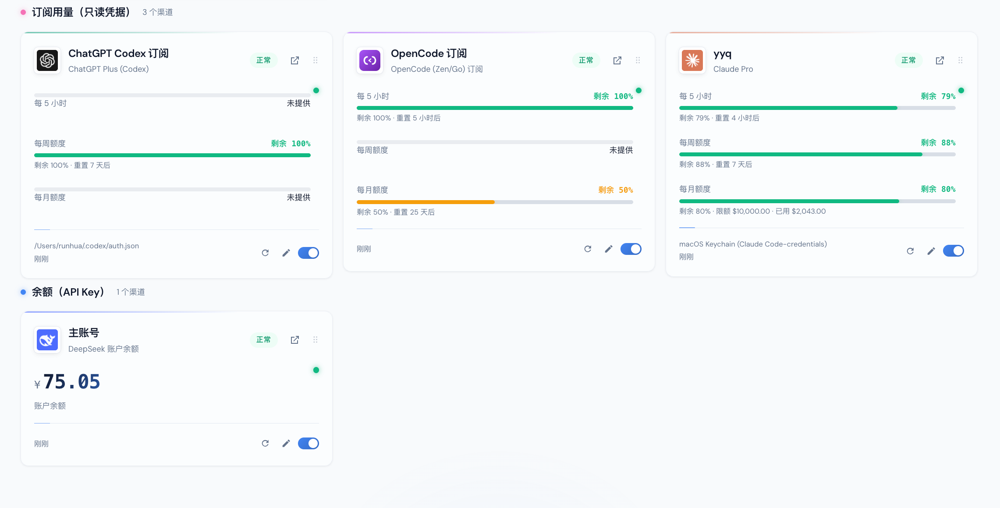
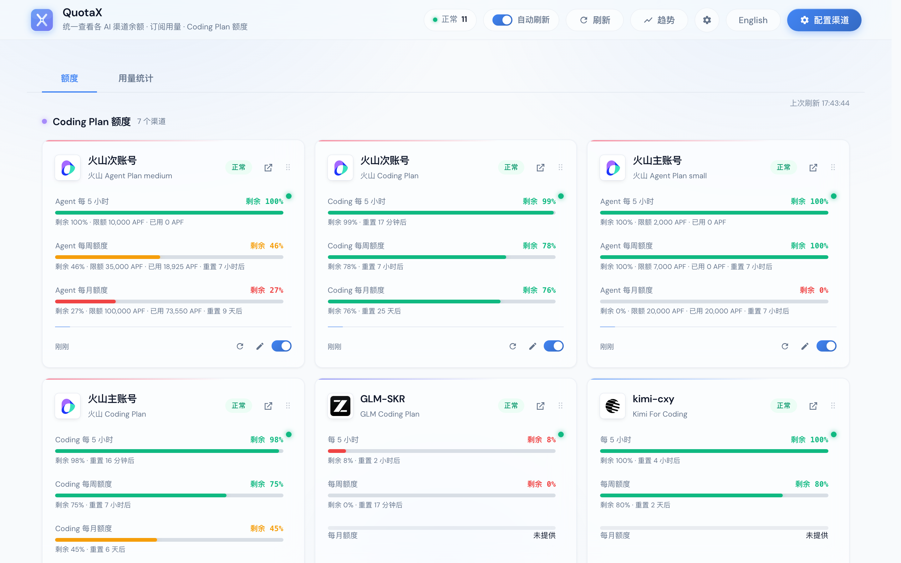
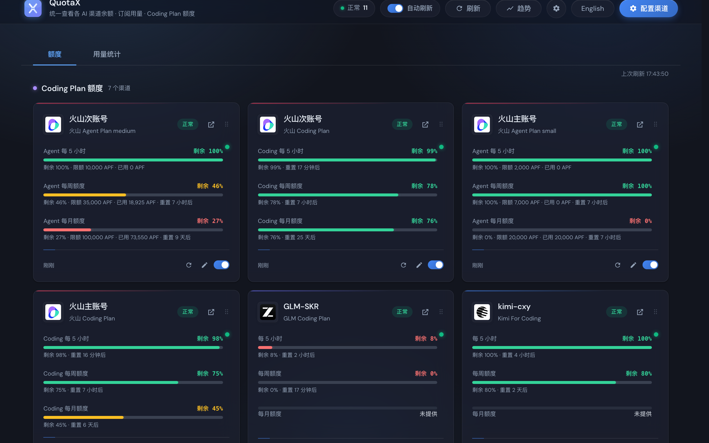
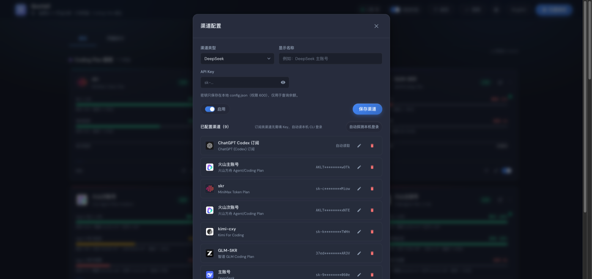
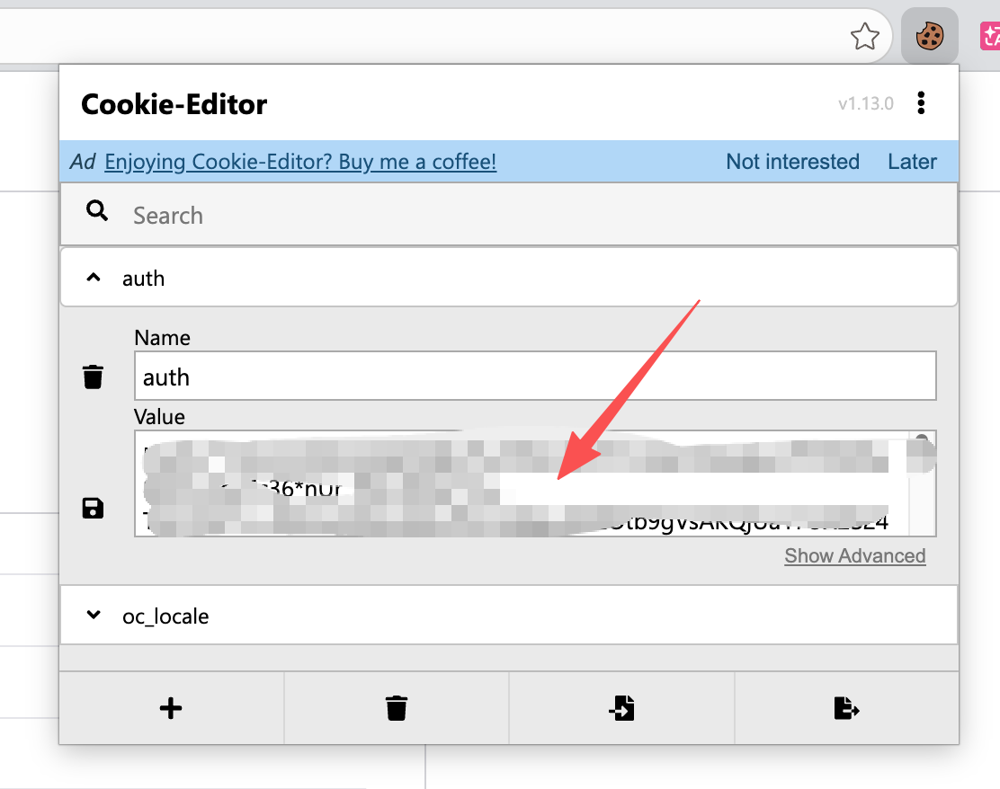
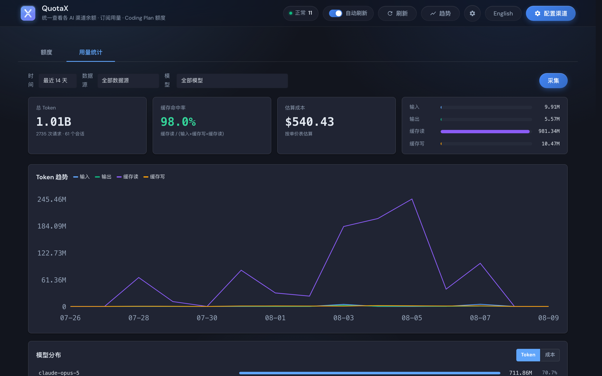
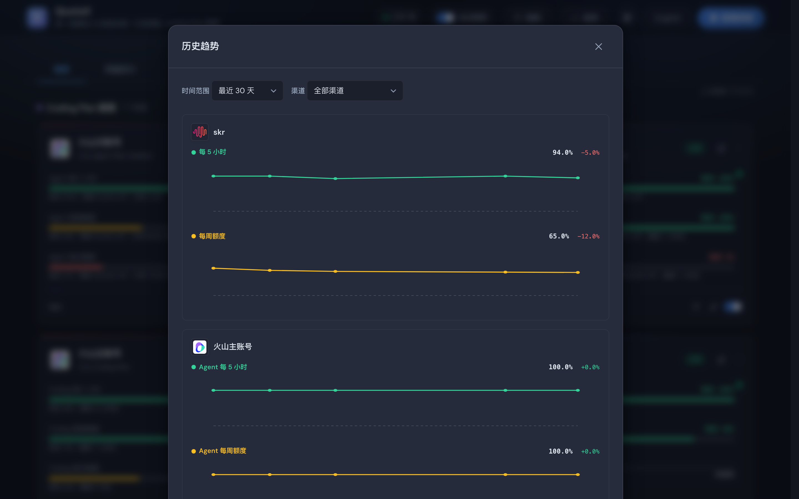
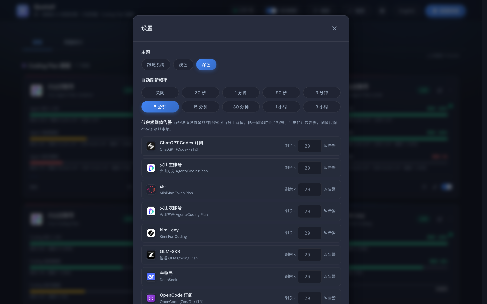

# QuotaX

> 统一查看各 AI 渠道**余额 · 订阅用量 · Coding Plan 额度**的本地 WebUI。

[English](./README.en.md) | 简体中文

把散落在各家官网 / CLI / 控制台里的余额和额度数字，聚合到一个本地面板上，一眼看完。订阅类渠道自动读取本机 CLI 登录态，无需填写任何密钥。



上方为订阅用量（Claude / Codex / OpenCode，自动读本机 CLI 登录态），下方为 API Key 余额（DeepSeek）。每个渠道一张卡，剩余百分比 + 重置倒计时一目了然。



---

## 特性

- **多渠道聚合**：余额（DeepSeek / 阶跃 / 硅基 / OpenRouter / Novita / Kimi API / 中转站）、Coding Plan（Kimi / 智谱 GLM 个人+团队 / MiniMax / 火山方舟 / ZenMux / 小米 MiMo）、订阅用量（Claude / Gemini / Grok / Codex / Copilot / OpenCode）、本地统计（Claude Code / OpenCode transcript）。
- **订阅渠道免填密钥 + 自动探测**：自动读取本机 CLI 的登录凭据（Claude / Gemini / Grok / Codex / Copilot），**不刷新、不写入**，与你的 agent 共享同一份登录态。服务启动时自动探测本机已登录的 CLI 并创建对应渠道，无需手动添加。
- **用量统计看板（深度分析）**：独立 Tab，基于 SQLite 持久化的增量采集，提供四桶 token 总览、缓存命中率、按天趋势曲线、模型分布、逐请求日志、成本估算（LiteLLM 单价表 + rebill 回填）。
- **Codex OAuth 在线授权**：ChatGPT 订阅支持在 WebUI 点一下「通过 ChatGPT 登录」完成 OAuth 授权，自动获取凭据并创建渠道。
- **逐渠道刷新 + 请求合并**：成功数据按所选周期更新，临时错误自动退避重试，429 遵守冷却；慢渠道不阻塞其他卡片。
- **长期开页恢复**：休眠唤醒、标签页解冻、返回页面和断网重连时自动检查过期请求并恢复刷新；初始化失败可以在原标签页重试。
- **运行诊断**：页面底部显示实际服务版本、运行目录、数据目录、采集状态和下次刷新时间；服务升级后提示重新加载，保留尚未提交的编辑内容。
- **拖拽排序**：卡片可拖拽自定义顺序，顺序持久化到浏览器 `localStorage`。
- **历史趋势**：每次成功查询自动记录一条趋势点，用 SVG 折线图展示余额 / 剩余百分比随时间的变化。
- **浏览器无关的后台告警**：阈值持久化到后端；可按周期持续检查，支持桌面通知、Webhook、重复告警冷却和恢复通知，关闭浏览器后仍可运行（默认关闭，需显式开启）。
- **中 / 英双语**：界面支持简体中文与 English 一键切换。
- **深 / 浅色主题**：跟随系统或手动切换。
- **CLI 终端工具**：`quotaboard quota --brief` 单行摘要，适合 tmux statusbar / shell prompt。
- **配置导入 / 导出**：含密钥完整备份（换机迁移）或脱敏导出（安全分享渠道结构）。



## 一键安装

打开终端，粘贴对应你系统的命令回车即可——脚本会自动下载源码、准备 Python 运行时、安装全部依赖、启动服务，最后帮你打开浏览器。

**macOS / Linux：**

```bash
curl -fsSL https://raw.githubusercontent.com/RunhuaHuang/quotax/v1.3.0/install.sh | bash
```

**Windows（PowerShell）：**

```powershell
irm https://raw.githubusercontent.com/RunhuaHuang/quotax/v1.3.0/install.ps1 | iex
```

> - 首次安装会自动准备运行时：**优先复用本机已有的 Python 3.11+**；本机完全没有时才自动安装 Python 3.13。无需用户预装 Python。请耐心等待 1–2 分钟。
> - 默认安装到 `~/QuotaX`（Windows 为 `%USERPROFILE%\QuotaX`），服务监听 `127.0.0.1:8900`。
> - **安装后自动探测**：本机已登录的 Claude / Codex / Gemini / Grok / Copilot CLI 会被自动识别并创建对应渠道，无需手动添加。
> - **网络不通 / GitHub 被墙？** 脚本内置多源镜像自动 fallback（GitHub → ghfast.top → gh-proxy.com → moeyy）；也可手动指定镜像：
>   ```bash
>   QUOTAX_MIRROR=https://ghfast.top bash -c "$(curl -fsSL https://raw.githubusercontent.com/RunhuaHuang/quotax/v1.3.0/install.sh)"
>   ```
>   ```powershell
>   $env:QUOTAX_MIRROR='https://ghfast.top'; irm https://raw.githubusercontent.com/RunhuaHuang/quotax/v1.3.0/install.ps1 | iex
>   ```
> - **升级**：重新跑一次同样的命令即可，`config.json` / `monitor-state.json` / `usage.db` / `history/` 等个人数据会自动保留。

### 后续打开

首次安装完成后，以后每次打开只需在终端输入：

```
quotax
```

这会自动启动后台服务并打开浏览器（服务已在运行则直接打开浏览器）。其他命令：

| 命令 | 作用 |
| --- | --- |
| `quotax` | 启动服务并打开 WebUI（已运行则直接打开） |
| `quotax stop` | 停止后台服务 |
| `quotax status` | 查看运行状态 |
| `quotax log [N]` | 查看最近 N 行日志（默认 50，仅 macOS/Linux） |

## 支持的渠道

| 分类 | 渠道 | 认证方式 |
| --- | --- | --- |
| 余额 | DeepSeek / 阶跃星辰 / 硅基流动 / OpenRouter / Novita / Kimi API / 智谱 API 余额 / new-api·one-api 中转站 | 填 API Key |
| Coding Plan | Kimi For Coding / 智谱 GLM Coding（个人+团队）/ MiniMax Token Plan / 火山方舟 Agent·Coding Plan（AK/SK **或 arkcli 登录态**，含团队版窗口）/ ZenMux / 小米 MiMo / 阿里云百炼 Token Plan | 填 API Key / AK·SK / Cookie |
| 订阅用量 | Claude Pro·Max / Gemini AI Studio / Grok SuperGrok·X / ChatGPT Codex / GitHub Copilot / OpenCode Zen·Go / Cursor 订阅 | Claude/Gemini/Grok/Codex/Copilot/Cursor **自动读取本机 CLI·IDE 登录**；OpenCode 填 **Cookie + 工作区 ID**；百炼填 **Cookie**（region：cn 大陆版 / intl 国际版） |
| 本地统计 | Claude Code / OpenCode 本地已用 token（+ OpenCode 费用，如果有） | 无（读本机文件/数据库） |



### new-api / one-api 中转站

优先尝试原生 `/api/user/self`；如果部署要求"系统访问令牌 + `New-API-User` 头"而不是普通业务 `sk-` key，可以在渠道配置里额外填一个可选的 `user_id`（对应 `New-API-User` 请求头），或者干脆不填，让它自动回退到 OpenAI 兼容的 `/v1/dashboard/billing/subscription` + `/v1/dashboard/billing/usage`。

### 火山方舟

同一账号可以**同时开通 Agent Plan 和 Coding Plan**，两个套餐会分别查询并**以左右 tab 展示**（卡片顶部「Agent Plan」/「Coding Plan」两个 tab，点哪个看哪个；每个 tab 内 5 小时 / 每周 / 每月窗口横排一行；没查到的套餐不显示对应 tab）。窗口 key 带 plan 维度（`agent_*`/`coding_*`），历史趋势图也会按套餐分线。其中一个套餐查询失败不影响另一个的展示。Access Key 请在火山引擎控制台创建：https://console.volcengine.com/iam/keymanage

### 小米 MiMo

用量查询端点（`platform.xiaomimimo.com/api/v1/tokenPlan/usage`）只接受小米账号登录后的 **Cookie**（不是 API Key）。请登录 platform.xiaomimimo.com 后，从浏览器开发者工具复制完整 Cookie 填入渠道配置的「Cookie」字段。

### OpenCode (Zen/Go)

opencode 官网是 SSR 页面、没有公开的 JSON API，额度数据（滚动 / 周 / 月三个周期的已用百分比和重置倒计时）以内嵌的 React Server Component 序列化字符串写在 `https://opencode.ai/workspace/<工作区ID>/go` 页面的 HTML 里。需要登录态，需要从浏览器复制两样东西填入渠道配置：① 完整 **Cookie**；② 地址栏里的**工作区 ID**（`wrk_xxx` 格式）。Cookie 只保存在本地 config.json（权限 600），仅用于只读查询。

**获取 Cookie 的步骤（推荐用 Cookie-Editor 插件）：**

1. 在 Chrome / Edge / Firefox 安装 [Cookie-Editor](https://cookie-editor.cgagnier.ca/) 插件（免费开源）。
2. 浏览器登录 [opencode.ai](https://opencode.ai)，进入你的 workspace 页面（地址栏能看到 `wrk_xxx`）。
3. 点击浏览器工具栏的 Cookie-Editor 图标，会列出当前站点的所有 Cookie。
4. 找到名为 **`auth`** 的那一条（通常在列表顶部），点开它，复制 **Value** 字段的完整值。

   

5. 也可以点底部「导出」按钮（带方框的图标）→ 选 **Export as Header**，得到一整段 `Cookie: name=value; ...` 文本，直接整段粘贴到渠道配置的 Cookie 字段即可（程序会自动解析）。

> 如果不想装插件，也可以用浏览器开发者工具（F12 → Application/应用 → Cookies → `opencode.ai`）逐条复制，但 Cookie-Editor 的 Export as Header 更省事。

实现参考 [Doueen/opencode-usage-extension](https://github.com/Doueen/opencode-usage-extension)。

### ChatGPT (Codex) 订阅

有三种获取凭据的方式：

1. **OAuth 在线授权**（推荐）——新建 Codex 渠道时点「通过 ChatGPT 登录」，浏览器会打开 OpenAI 授权页，用 ChatGPT 账号登录授权后自动完成 PKCE 流程换回 token、解析 account_id、自动创建渠道，全程不用手动碰任何文件，多账号只需多点几次分别授权。
2. **上传 auth.json**——如果本机已经用 Codex CLI 登录过，可以直接上传 `~/.codex/auth.json`（多账号场景每个渠道配一份）。
3. **自动读取本机 CLI 登录态**——不填任何东西，自动读 macOS Keychain 里的 `Codex Auth` 或 `~/.codex/auth.json`。

OAuth 实现参考 [CLIProxyAPI](https://github.com/router-for-me/CLIProxyAPI)（client_id / endpoints / PKCE / id_token 解析均与其一致）。

### Claude Code 订阅：可能只有本地统计，没有实时用量

新版 Claude Code 在 macOS 上，账号登录状态存在钥匙串条目 `Claude Code-credentials` 里，但**这个条目不一定包含明文 access token**——如果 `accessToken`/`refreshToken` 是空字符串（只有 `subscriptionType` / `rateLimitTier` / `scopes` 等元信息），说明账号确实已登录，只是本机没有存储可用的 token，查不了官方用量窗口（`api.anthropic.com/api/oauth/usage`）。

这不是"未登录"，所以本项目**不会**提示"请重新登录"。遇到这种情况，本项目会**自动尝试 PTY 探测**：用伪终端（PTY）启动 `claude` CLI 执行 `/usage` 命令——CLI 自己拥有 Keychain 访问权限，能在终端里显示出真实用量面板，本项目解析终端文本即可拿到「每 5 小时 / 每周」的剩余百分比（参考 [CodexBar](https://github.com/steipete/CodexBar) 的 `ClaudeStatusProbe`）。如果 PTY 探测也不可用（CLI 未安装或未登录），才降级为 `status: "info"` + 本地 transcript 统计。

> PTY 探测的前提是 Claude CLI 已在本机登录（`claude` 能正常使用）。

## 用量统计看板（深度分析）



顶栏「额度 / **用量统计**」Tab 切换。用量统计 Tab 是一个独立的深度分析看板，基于 SQLite 持久化的增量采集，提供趋势 / 模型分布 / 请求日志 / 成本估算等维度，设计参考 [Buktal/VaultOne](https://github.com/Buktal/VaultOne)。

解析结果落库到 `usage.db`（与 config.json 同目录），支持历史趋势、逐请求明细和增量扫描。自 1.3.1 起，额度页的本地已用统计也复用这份数据库，统一采用 UTC 自然日口径，不再在每次页面刷新时全量扫描 transcript；最近采集时间显示在统计区上方。CLI 的独立本地统计命令仍可直接读取日志。

### 数据源

只读本机各 AI CLI 的日志文件 / 数据库，不发任何网络请求：

| 数据源 | 路径 | 格式 | 说明 |
| --- | --- | --- | --- |
| Claude Code | `~/.claude/projects/*/*.jsonl` | JSONL | `type=assistant` 行的 `message.usage`，按 `message.id` 去重 |
| Codex | `~/.codex/sessions/**/*.jsonl` + `archived_sessions/*.jsonl` | JSONL | `token_count` 事件的 `last_token_usage` 是本轮增量；input 含 cache 需归一化 |
| Gemini CLI | `~/.gemini/tmp/<hash>/chats/session-*.json` | 单 JSON | `role=model` 消息；input 含 cache；output 含 thoughts |
| Grok CLI | `~/.grok/sessions/<cwd>/<uuid>/updates.jsonl` | JSONL (JSON-RPC) | `turn_completed` 事件的 `usage`；input 含 cache |
| OpenCode | `~/.local/share/opencode/opencode.db` | SQLite | 新版读 session 聚合列，老版解析 message.data JSON |

**cache-inclusive 归一化**：Codex / Gemini / Grok 的 input 字段都包含缓存命中的部分，解析时会统一减去 `cache_read` 得到"新鲜输入"，与 Claude Code 的口径对齐。

**增量采集**：JSONL 源记录每个文件的 `(mtime, line_offset)` 游标，只读游标之后的新行；Codex 还保存增量起点的模型上下文。遇到被并发写入的截断行时保留旧游标，下次重读。SQLite 源（OpenCode）优先按 rowid 增量，新版可变 session 聚合会重读最后一行并更新已有记录；旧游标会先迁移到 rowid 语义。重复采集幂等（按主键去重或更新聚合记录），不会产生重复记录。

用量看板的总览、趋势、模型分布、请求日志和模型筛选统一按 **UTC 自然日** 计算；选择 14 天时包含今天及之前 13 个自然日，避免不同区块因滚动 24 小时窗口产生口径差异。

### 前端看板

进入「用量统计」Tab 后首次加载，包含：

- **总览 KPI**：总 token（四桶合计）、缓存命中率（`cache_read / (input + cache_creation + cache_read)`，output 不进分母）、估算成本、请求数 / 会话数；四桶占比条。
- **Token 趋势曲线**：纯 SVG 折线图，4 条独立线（input / output / cache_read / cache_creation），按天聚合，补零保证曲线连续。
- **模型分布**：Top 8 + 其他汇总，支持 **token / 成本** 两种度量切换；点击模型名可联动筛选整个看板。
- **请求日志表**：逐请求明细（时间 / 来源 / 模型 / 四桶 token / 合计 / 成本 / 停止原因），按时间倒序，停止原因有语义着色（`end_turn` 绿 / `tool_use` 蓝 / `max_tokens` 黄 / `error` 红）。
- **筛选**：时间范围（7/14/30/90 天）、数据源、模型三维筛选，联动所有区块。

### 成本估算与单价表

成本是**按单价表估算**的，不是真实账单——单价表来源：

1. **内置价**：项目自带一份常见模型的单价（随版本更新）。
2. **LiteLLM 拉取**：点「从 LiteLLM 更新单价」从 [LiteLLM model_prices](https://raw.githubusercontent.com/BerriAI/litellm/main/model_prices_and_context_window.json) 拉取最新单价，覆盖内置价。
3. **手动编辑**：在单价表面板手动添加 / 覆盖任意模型的输入 / 输出 / 缓存读 / 缓存写单价。

所有持久化的单价只存在本地 `usage.db` 的 `model_pricing` 表，与代码内置价合并后用于成本计算。已有记录的单价变更后可点「补算 0 成本记录」对历史数据重新算费。

## 卡片排序

仪表盘卡片默认按**分类**（Coding Plan → 订阅 → 余额 → 本地）分组展示。每个分类内部，可以**拖拽卡片右下角的把手（⠿）自由排序**：

- 拖动一张卡到同分类内另一张卡的位置，两张卡交换顺序；
- 顺序持久化到浏览器 `localStorage`（`quotaboard_prefs.card_order`），刷新或重开浏览器后保留；
- 新增的渠道会追加到该分类末尾；
- 跨分类拖拽会被拦截（卡片归属哪个分类由后端决定，前端不能改）。

## 历史趋势



点顶栏「趋势」打开。每次成功的额度查询会自动记录一条趋势点（历史数据存 `history/` 子目录下的 JSONL，与 config.json 同目录）。支持按渠道、按时间范围（7/14/30/90/180 天）筛选，用 SVG 折线图展示余额或剩余百分比随时间的变化。火山渠道的 Agent / Coding 两个套餐会分线展示。

## 低余额阈值告警



在设置弹窗里为每个渠道设置「剩余百分比阈值」。阈值会同步写入本机 `config.json`，旧版本浏览器 `localStorage` 中的阈值会自动迁移一次。低于阈值时：卡片边框标橙、状态点变红；顶栏汇总栏出现「低额度」计数。

「后台持续监控」默认关闭。显式开启后，QuotaX 服务会按设定间隔复用现有缓存/请求合并机制检查额度，即使浏览器已关闭也能工作。可启用系统桌面通知、填写可选 Webhook，并设置重复告警冷却时间；额度恢复到阈值以上时也会发送恢复事件。告警活动状态和冷却水位保存在 `monitor-state.json`，服务重启后不会立刻重复轰炸。

Webhook 接收 `{"source":"QuotaX","version":1,"event":{...}}` JSON；`event.type` 为 `alert` 或 `recovered`。Webhook 地址可能包含签名，因此脱敏导出会自动清空它。

同一设置页还可配置本地用量历史保留天数。QuotaX 每天最多清理一次过期 `usage.db` 记录和已不存在日志文件的扫描游标。

## 配置导入 / 导出

配置弹窗底部：

- **导出配置（含密钥）**：导出完整配置（含明文 API Key 与 Webhook URL），用于个人备份 / 换机迁移。请妥善保管。
- **导出（脱敏）**：导出不含密钥和 Webhook URL 的渠道/监控结构，可安全分享给他人参考配置。
- **导入配置**：导入时会弹窗选择**合并**（追加到现有配置，同 id 覆盖，更安全推荐）或**替换**（清空现有全部渠道后替换）。

## 不抢登录的设计

自动探测的订阅渠道只读取本机 CLI 凭据或钥匙串，QuotaX 不会修改这些文件，也不会主动刷新它们的 token。Claude 的 PTY 回退会调用本机 Claude CLI 的 `/usage`；CLI 自身的登录处理由 CLI 决定。

用户主动上传 Codex `auth.json` 或通过 OAuth 授权时，QuotaX 会在自己的用户数据目录 `credentials/` 下保存独立凭据文件，不覆盖 CLI 的登录文件。凭据过期后需要重新登录、授权或上传。

## CLI 终端集成

除了 WebUI，还提供命令行工具（`quotaboard`，通过 `uv run quotaboard` 调用），适合在终端、tmux、shell prompt 或脚本里一次性查询额度：

```bash
uv run quotaboard quota                  # 查询所有渠道额度摘要（终端分栏）
uv run quotaboard quota --json           # JSON 输出（便于脚本解析）
uv run quotaboard quota --brief          # 精简模式（适合放 shell prompt）
uv run quotaboard quota --ids ch_a,ch_b  # 只查指定渠道
uv run quotaboard channels               # 列出已配置渠道（密钥打码）
uv run quotaboard cost --days 7          # 本地已用 token 统计
```

退出码：`0` 全部正常；`1` 有 error/expired 渠道；`2` 配置损坏或用法错误——适合在脚本里做健康检查。

## 刷新与故障恢复

- 首次打开先恢复画面，再按渠道更新；单卡、全局和自动刷新共享请求管理，旧请求不会覆盖编辑后的数据。
- 自动刷新默认 5 分钟，可选 30 秒至 3 小时。成功数据的有效期按该周期计算，但最多 30 分钟；HTTP API 可传 `max_age_seconds=30..86400`，默认 300，实际缓存有效期上限为 1800 秒。后台监控按自己的间隔查询，共享缓存与请求合并。
- 同一渠道只执行一次并发上游查询，全局最多 4 个；每个渠道含排队和多个接口在内最多等待 45 秒。前端逐卡显示结果，不等最慢渠道。
- 临时错误按 30 / 60 / 120 / 240 / 300 秒退避；浏览器启用自动刷新时会按重试时间提前检查。429 使用 `Retry-After`（秒数或 HTTP 日期），缺失时冷却 15 分钟，手动刷新也不会绕过限流。凭据失效提示重新登录，自动检查间隔为 5 分钟。
- 查询失败在 30 分钟保留期内保留最近成功数值，标记 `stale` 并显示错误，旧值不用于触发或解除监控告警。修改密钥或导入配置会清除旧缓存。
- 查询结果和页面会话快照最多保留 30 分钟；后端每分钟清扫，即使没有浏览器访问也会清理，读取时立即拒绝过期数据。页面运行时定期清理快照，冻结或休眠后在恢复时清理；旧版无时间戳快照直接丢弃。失败重试和其他渠道更新不会延长旧数据的寿命，较长的上游限流期限仍会遵守。账号、偏好、历史数据库和各 CLI 原始会话日志不属于临时缓存，不在此清理范围。
- 卡片显示数据年龄及最早可再次查询时间，顶部显示最近检查时间。自动刷新关闭时，卡片年龄仍继续更新；页面隐藏/离线时暂停轮询，恢复后检查过期数据。
- 顶部刷新作用于当前视图：额度页更新额度并读取最新已采集的本地汇总，用量页执行采集并重载统计。后台每轮采集完成后等待 60 秒再增量采集；多标签页与手动采集共享正在运行的任务。本地汇总直接查询 SQLite，不阻塞额度卡片刷新。
- 所有刷新请求覆盖响应体读取超时，恢复页面时按实际经过的时间清理失效请求；同时监听 `visibilitychange`、`resume`、`pageshow`、`focus`、`online`，并检测休眠造成的定时器间隔跳变。自动刷新关闭时不会因恢复事件重新开启。
- 页面底部「运行状态」可检查正在运行的版本和安装位置，避免更新源码却仍使用旧安装副本。HTML/静态资源会重新验证缓存；升级提示由用户点击重新加载，避免丢失表单编辑。

## 数据目录与升级

代码默认安装在 `~/QuotaX`，个人数据独立存放：

| 系统 | 默认数据目录 |
| --- | --- |
| macOS | `~/Library/Application Support/QuotaX` |
| Linux | `${XDG_DATA_HOME:-~/.local/share}/quotax` |
| Windows | `%LOCALAPPDATA%\QuotaX` |

目录包含 `config.json`、`credentials/`、`usage.db`、`history/` 和 `monitor-state.json`。首次启动会将旧安装目录的数据复制到新目录；SQLite 通过备份接口包含已提交的 WAL 数据，迁移失败不会删除原文件。已有新配置优先，遇到有其他数据却缺少配置的目录会停止并提示检查，不混合覆盖。

可用 `QUOTAX_DATA_DIR` 指定整个数据目录；`QUOTABOARD_CONFIG` 指定配置文件时不自动迁移，适合隔离测试或保留旧部署路径。升级前后请勿同时运行旧版和新版写入两份不同数据；回退旧版时可以将 `QUOTABOARD_CONFIG` 指向新目录中的配置。确认迁移后再自行处理旧副本。

备份时先停止服务，再备份整个数据目录。仅导出配置不会包含数据库、趋势记录或上传的凭据文件。卸载程序不删除用户数据。

## 运行诊断

- `GET /api/health`：版本、配置状态、SQLite 大小/记录数、最近采集和后台监控状态；
- `GET /api/runtime`：供页面使用的轻量版本、运行/数据目录和采集状态；
- `GET /api/monitor/status`：后台调度、上/下次检查、活动告警和最近错误；
- `POST /api/monitor/run`：立即执行一轮（默认强制刷新）；
- `GET /api/usage/status` / `POST /api/usage/cleanup`：本地用量采集与保留清理诊断。

## 安全说明

- 默认监听 `127.0.0.1`，本机可直接使用；非本机来源或自定义域名未设置访问密码时拒绝访问。
- API Key / AK·SK / Cookie 仅保存在本地 `config.json`（权限 `600`）；上传或 OAuth 生成的 Codex `auth.json` 保存在同目录 `credentials/`（目录 `700`、文件 `600`）。查询时凭据只发送给用户配置的对应服务商，不经过 QuotaX 自有服务器。
- 后台监控默认关闭；只有用户显式启用的桌面通知或 Webhook 才会接收告警。Webhook URL 在脱敏导出中会被删除。
- 自动读取的 CLI 凭据不会被 QuotaX 修改；主动上传/OAuth 产生的凭据独立保存，详见上文。
- 默认不跟随重定向（`follow_redirects: false`），防止恶意 base_url 3xx 跳转泄露 Authorization 头。
- DNS rebinding 防护：校验请求 Host 头白名单，防止恶意网页跨域读取本机接口。

## 远程访问

各自在本机安装是推荐的分享方式。需要访问同一个实例时，设置 `QUOTAX_ACCESS_PASSWORD`（长随机密码），浏览器使用用户名 `quotax` 登录。密码保护页面和全部 API；`/healthz` 仅返回无个人信息的存活状态。Host 白名单和跨站请求检查仍保留。

macOS/Linux 可在安装目录 `quotax.env`（权限 `600`）中设置并重启：

```sh
QUOTAX_ACCESS_PASSWORD='替换为长随机密码'
QUOTAX_ALLOWED_HOSTS='quota.example.com'
```

反向代理将 HTTPS 请求转发至 `127.0.0.1:8900` 并保留 Host。只有需要直接监听局域网时才设置 `QUOTAX_HOST=0.0.0.0`。Basic 登录必须配合 HTTPS；访问密码是整个实例的管理权限，持有者能读取/修改所有渠道和密钥，不提供多用户数据隔离。不要给只应查看额度的人共享这个管理实例。Windows 可在启动服务前设置同名环境变量。

## 打包给朋友与发布检查

```sh
uv sync --locked
uv run pytest -q
node --test tests/frontend/*.test.mjs
npm ci
npx playwright install chromium
npm run test:browser
uv run ruff check app tests scripts
uv build --wheel
uv run python scripts/package_release.py
```

`dist/quotax-1.3.2-source.zip` 采用源码白名单生成，并附带 SHA-256 校验文件；不包含个人配置、凭据、数据库、虚拟环境或未纳入分发范围的工作文件。朋友解压后在目录运行 `bash install.sh`，Windows 运行 `powershell -ExecutionPolicy Bypass -File .\install.ps1`；本地源码安装无需下载 GitHub 源码，但首次仍需获取依赖。

浏览器回归测试使用临时数据目录和模拟账号，不读取本机凭据、不查询真实渠道；覆盖首屏故障重试、冻结恢复、断网重连、服务重启、页签刷新及升级提示。已安装 Chrome 时，可用 `QUOTAX_TEST_BROWSER_CHANNEL=chrome npm run test:browser`，无需另外下载 Chromium。

远程安装默认固定 `v1.3.0` 标签，开发版需显式设置 `QUOTAX_VERSION=main`。**远程安装命令需在维护者发布对应标签后使用；尚未发布时使用本地源码 ZIP。** CI 已配置 macOS / Linux / Windows、Python 3.11 / 3.13 的测试、脚本语法检查、wheel 构建和脱离源码目录的安装冒烟检查；工作流通过后再发布标签。

## 开发

```bash
git clone https://github.com/RunhuaHuang/quotax.git
cd quotax
uv sync --locked             # 安装依赖（复用本机 Python 3.11+）
uv run pytest                # 跑全部后端测试
uv run uvicorn app.main:app --port 8900   # 启动开发服务
```

测试时用环境变量指向临时配置，避免碰到真实的 `config.json`：

```bash
QUOTABOARD_CONFIG=/tmp/quotax-test/config.json uv run uvicorn app.main:app --port 8931
```

前端是纯静态文件（无构建步骤），改完 `static/` 下的 JS/CSS 刷新即可。

## 技术栈

- **后端**：Python 3.11+ · FastAPI · httpx · 无外部数据库（config.json + SQLite + JSONL）
- **前端**：原生 ES Modules · 零构建零依赖 · 自托管字体（DM Sans + JetBrains Mono）
- **运行时管理**：uv（自动管理 Python 版本与虚拟环境）

## 参考实现

- [CodexBar](https://github.com/steipete/CodexBar) — Claude PTY 用量探测、Codex 凭据解析
- [CLIProxyAPI](https://github.com/router-for-me/CLIProxyAPI) — Codex OAuth PKCE 流程
- [Buktal/VaultOne](https://github.com/Buktal/VaultOne) — 用量统计看板设计
- [Doueen/opencode-usage-extension](https://github.com/Doueen/opencode-usage-extension) — OpenCode 额度解析
- [BerriAI/litellm](https://github.com/BerriAI/litellm) — 模型单价表数据源
